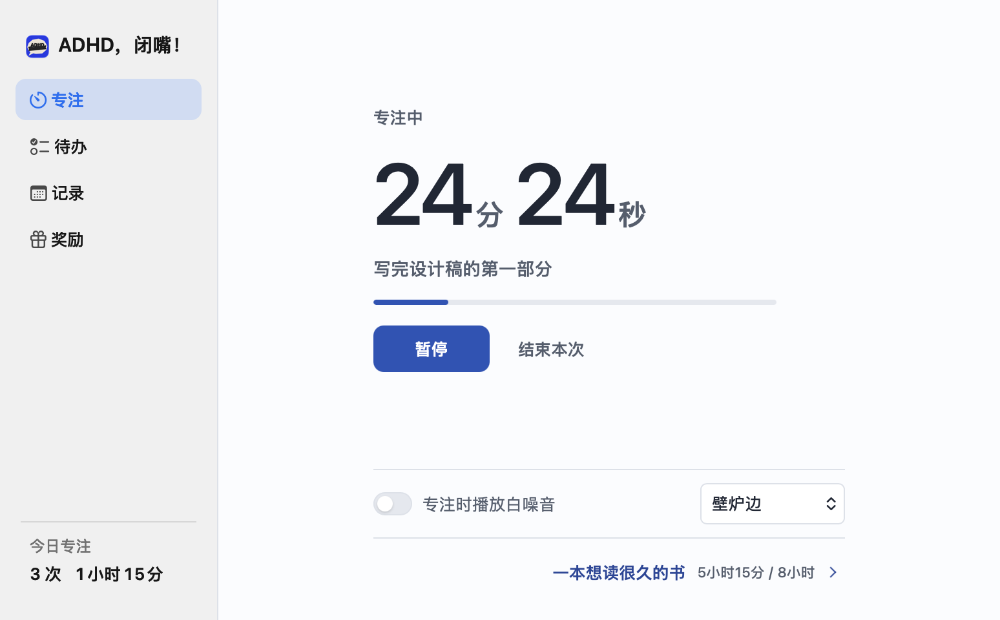
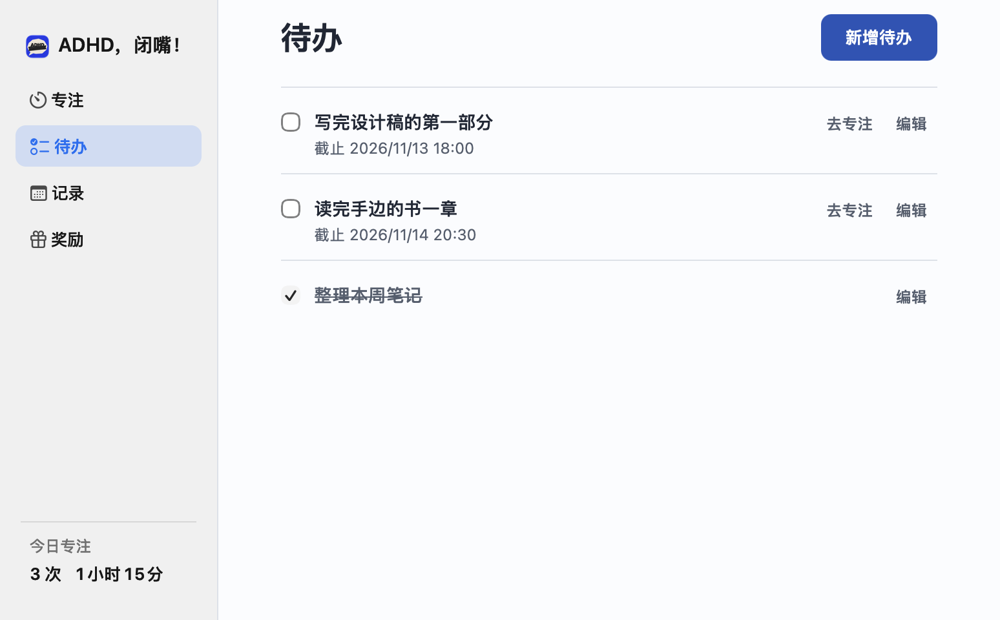
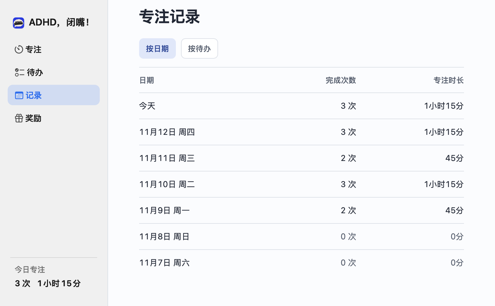
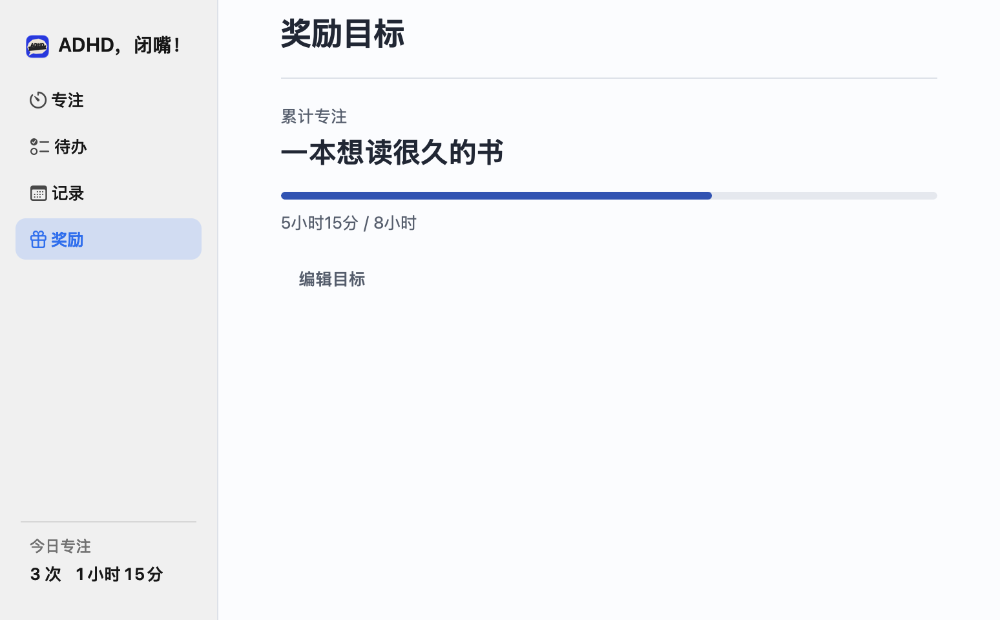

# ADHD，闭嘴！

> 这段时间我说了算。先做眼前这一件，ADHD，等会儿再吵。

「ADHD，闭嘴！」是一款待在 Mac 菜单栏里的专注计时器。选一件事，按下开始，做一会儿，再歇一会儿。

**[下载 macOS 安装包（DMG）](https://github.com/moss0428/adhd-shut-up/releases/download/v0.1.21/adhd-shut-up-v0.1.21-macos-universal.dmg)** · [查看 Releases](https://github.com/moss0428/adhd-shut-up/releases)

需要 macOS 14 或以上，支持 Apple 芯片和 Intel Mac。

## 为什么做这个 App

有时候，明明知道要做什么，还是迟迟开始不了。好不容易坐下来，脑子里又同时冒出好几件事，手也已经点开了别的窗口。

我做「ADHD，闭嘴！」，是想让开始这件事简单一点。今天只做眼前这一件也可以，走神了就回来。每次做完，菜单栏的小人会比个耶，你也可以去歇一会儿。希望有 ADHD 症状、常被分心和拖延打断的人，能用自己舒服的节奏，把注意力一点点拿回来。

## 能做什么

- **专注计时**支持 15、30 分钟和自定时长。右侧菜单栏可以快速开始 30 分钟专注，也可以暂停、继续或停止。专注结束后可以选择休息。
- **白噪音**可选「阴天小雨」「咖啡店」「图书馆」和「壁炉边」。内置音源在专注计时运行时循环播放。[音源素材](assets/audio/SOURCES.md)
- **待办和记录**支持为待办设置截止时间并关联专注。可以按天或按待办查看完成次数和时长，提前结束的专注不计入。
- **奖励**可以给想买的东西设置累计专注时长目标，达成后标记领取。

| 待办 | 专注记录 | 奖励目标 |
| --- | --- | --- |
|  |  |  |

截图使用示例数据。

## 安装

1. 从 [Releases](https://github.com/moss0428/adhd-shut-up/releases/latest) 下载 DMG。
2. 打开 DMG，把「ADHD，闭嘴！」拖到「应用程序」，再从「应用程序」打开。

GitHub 下载版尚未经过 Apple 公证。如果首次打开时被 macOS 拦截，确认文件来自此仓库的 Releases 后，可参照 Apple 的说明处理。 [Apple 支持](https://support.apple.com/zh-cn/102445)

## 从源码构建

项目使用 Rust、AppKit 和系统 WebKit。需要 Rust 1.89 或以上和 Xcode Command Line Tools。以下命令会把应用安装到当前用户的 `~/Applications`。

~~~sh
git clone https://github.com/moss0428/adhd-shut-up.git
cd adhd-shut-up
./scripts/package.sh --install
open "$HOME/Applications/ADHD，闭嘴！.app"
~~~

运行 `./scripts/package.sh` 可以在 `dist/` 生成本机签名的应用包。用 `cargo test --locked` 运行测试。应用的版本号可从菜单中的「关于 ADHD，闭嘴！」查看。

## 本地数据

待办、专注记录、奖励和设置保存在 `~/Library/Application Support/水滴/state.json`。白噪音随应用提供，可以离线播放。Mac 睡眠或退出应用时，进行中的计时会暂停，下次打开可以继续。

## 反馈与许可

欢迎在 [Issues](https://github.com/moss0428/adhd-shut-up/issues) 报告问题或提出建议。报告问题时，请附上 App 版本、macOS 版本和复现步骤。

项目代码、文档和自制图标采用 [MIT 许可](LICENSE)。第三方录音及音乐音色沿用各自的许可，详见 [音源来源与许可](assets/audio/SOURCES.md)。
